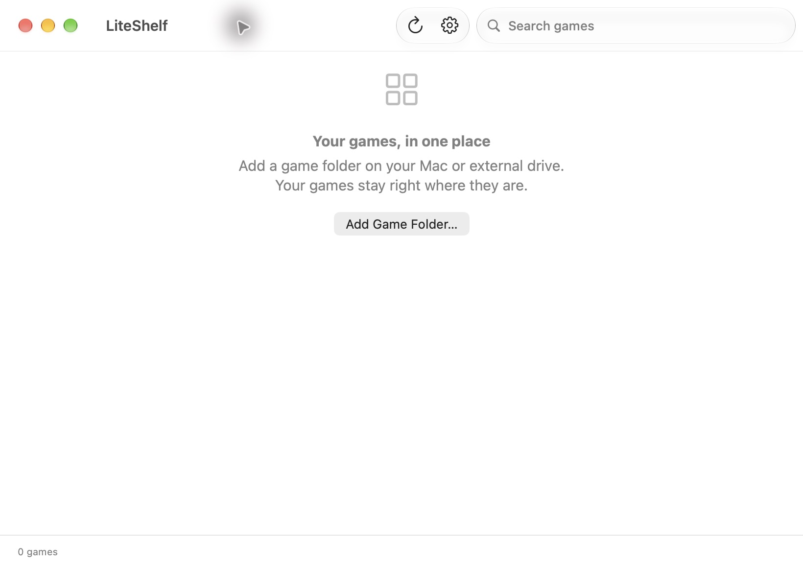

[English](README.md) | [简体中文](README.zh-CN.md)

# LiteShelf（轻游架）

LiteShelf（轻游架）是一款轻量、快速、完全离线的 macOS 原生游戏库，支持管理和启动本地及外置硬盘上的游戏。

游戏保留在您选择的位置。添加文件夹、浏览图标，双击即可启动。

## 功能特色

- **macOS 原生应用（Native macOS Application）**：使用 Swift、SwiftUI 和 AppKit，支持包括 M1 在内的 Apple Silicon，跟随系统深色与浅色外观。
- **轻量快速（Lightweight & Fast）**：先显示窗口，再在后台执行文件系统操作；使用本地 JSON 与 PNG 缓存，零第三方依赖。
- **外置硬盘支持（External Drive Support）**：游戏可保存在三星 T7 或其他硬盘，重新连接后恢复可用状态。
- **自定义文件夹扫描（Custom Folder Scanning）**：只扫描您主动选择的文件夹，不自动扫描 Applications 或游戏平台目录。
- **离线优先（Offline First）**：没有账户、网络请求、遥测或在线封面功能。
- **自动识别应用（Automatic App Discovery）**：递归识别 `.app`，读取名称、版本与 Bundle Identifier，使用系统原生图标。不遍历应用包内部、隐藏文件夹或符号链接。
- **持久化游戏库（Persistent Game Library）**：硬盘断开后仍保留游戏名称与图标；扫描无法读取时保留原有记录。
- **英文与简体中文（English & Simplified Chinese）**：跟随 macOS 语言偏好及应用单独语言设置。
- **无音乐和音效（Zero Music & Sound Effects）**：没有音频模块、音频资源或声音设置。

## 应用截图

macOS 27 上实际运行的英文空游戏库界面（中文界面及原生菜单也已实际验证，截图待补充）：



请参阅[截图说明](docs/screenshots/README.md)。不包含游戏宣传图或伪造截图。

## 系统要求

- Apple Silicon Mac（M1 或更新），macOS 14 或更新，包括 macOS 27。
- 游戏必须已经是完整、可运行并兼容本机的 macOS `.app` 应用。
- 源码构建需要 Xcode 16 或更新；验证 macOS 27 时建议使用 Xcode 27 与 macOS 27 SDK。
- 使用打包后的应用不需要安装 Xcode、Homebrew 或其他运行时，也不需要联网。

## 下载与安装

通过 [最新稳定版本](https://github.com/ohxiaoguang/liteshelf/releases/latest) 或 [全部版本及测试构建](https://github.com/ohxiaoguang/liteshelf/releases) 下载。目前尚未发布安装包，源码位于 [ohxiaoguang/liteshelf](https://github.com/ohxiaoguang/liteshelf)。

1. 选择 `LiteShelf-版本号-macOS-arm64.dmg`。文件名以 `-unnotarized.dmg` 结尾的为测试构建。
2. 可选校验：在下载目录执行 `shasum -a 256 -c LiteShelf-版本号-macOS-arm64.dmg.sha256`，请使用实际文件名。
3. 打开 DMG，将 **LiteShelf.app** 拖入 **Applications**。推出 DMG 后，从“应用程序”打开轻游架。

未配置 Developer ID 凭据时，构建仅带有临时（ad-hoc）签名，**未经 Apple 公证**，macOS 可能阻止打开。请仅在信任来源的前提下，遵循 Apple [打开来源不明开发者应用的官方说明](https://support.apple.com/zh-cn/102445)，例如在系统提供选项时使用 **系统设置 → 隐私与安全性 → 仍要打开**。不要全局禁用 Gatekeeper。也可以在本地从源码构建。

## 使用方法

1. 点击 **添加游戏文件夹…**，选择例如 `/Volumes/T7/Games/` 的目录。可在 **设置** 中添加多个文件夹。
2. 将已有 `.app` 游戏放入该目录或其子目录。轻游架仅读取元数据并缓存图标，不复制、不修改、不解包游戏。
3. 双击图标启动。也可以将图标聚焦后按回车，或右键选择 **启动**、**在 Finder 中显示** 和 **查看信息**。
4. 按名称搜索游戏。添加、移动或删除游戏后，使用 **刷新游戏库**（`⌘R`）。`⇧⌘O` 添加文件夹，`⌘,` 打开设置。
5. 在设置中移除文件夹只会删除其记录与图标缓存，不会影响硬盘中的游戏文件。

### 外置硬盘与权限

建议添加外置 SSD 上的游戏目录，除非确实想扫描整块硬盘，否则不要选择整个卷。轻游架保存只读 Security-Scoped Bookmark 与卷身份；解析书签时不会自动挂载磁盘，也不会弹出权限对话框。

硬盘断开时，缓存游戏会变为不可用并保留在列表中。磁盘挂载、卸载及卷重命名通知会触发后台刷新。重新连接后，书签可跟随更名或位置变化的卷，游戏相对路径会基于解析后的文件夹重新定位。若另一块硬盘占用了原挂载路径，卷身份检查会拒绝扫描。若系统无法解析书签或权限变化，请在设置中使用 **重新选择…**，选择原文件夹；如已搬移游戏，则选择新位置。应用不会搜索其他目录来猜测游戏位置。

仅在已连接文件夹的完整刷新成功后，才会移除实际已删除的游戏记录。扫描失败或不完整时保留不可用记录。重叠目录在网格中去重；移除其中一个目录后，属于其他已选目录的记录仍然保留。硬链接别名不合并；Bundle Identifier 相同的独立副本也分别保留。

### 中英文语言支持

英文为开发语言与回退语言。轻游架按 macOS 语言偏好列表顺序选择第一个支持的英文或中文偏好；所有 `zh` 变体均显示简体中文。没有支持的语言时回退英文，不使用地区或 IP 判断。若要单独指定语言，请进入 **系统设置 → 通用 → 语言与地区 → 应用程序**，选择 LiteShelf 并重新启动应用。应用内没有额外语言切换模块。AppKit 启动前仅在当前进程中规范化语言，因此中文变体下的原生菜单和对话框也使用简体中文，不会改写保存的语言设置。

## 从源码构建

在 Xcode 打开 `LiteShelf.xcodeproj`，选择 **LiteShelf** Scheme 与 **My Mac**，然后运行。命令行构建：

```sh
xcodebuild -project LiteShelf.xcodeproj -scheme LiteShelf \
  -configuration Release -destination 'generic/platform=macOS' \
  -derivedDataPath build/DerivedData CODE_SIGNING_ALLOWED=NO build
codesign --force --sign - build/DerivedData/Build/Products/Release/LiteShelf.app
open build/DerivedData/Build/Products/Release/LiteShelf.app
```

构建、校验并打包可独立运行、带有 ad-hoc 签名的 ARM64 应用：

```sh
./scripts/build-dmg.sh 1.0.0
```

产物为 `build/dist/LiteShelf-1.0.0-macOS-arm64-unnotarized.dmg` 及 `.dmg.sha256`。DMG 内含 LiteShelf.app、Applications 快捷入口，以及未公证测试版说明。请使用干净的输出目录，或通过 `OUTPUT_DIR` 指定新目录；脚本会拒绝覆盖现有安装包。还可设置 `DERIVED_DATA` 与 `BUILD_NUMBER`。无需工程生成器或包管理器。图标 PNG 已包含在源码中，`scripts/generate-icon.swift` 为可选的原生图标生成源码。

运行测试：

```sh
xcodebuild -project LiteShelf.xcodeproj -scheme LiteShelf \
  -configuration Debug -destination 'platform=macOS,arch=arm64' \
  -derivedDataPath build/TestData CODE_SIGNING_ALLOWED=NO test
```

应用刻意不启用 App Sandbox，以允许 macOS 启动用户所选的独立游戏。它使用安全作用域书签管理显式文件夹访问，不请求网络、不扫描未选择位置。Developer ID 签名时启用 Hardened Runtime；游戏启动仍由 Gatekeeper 管理。

### 数据与源码结构

游戏库元数据、只读书签与 128×128 PNG 图标保存在 `~/Library/Application Support/LiteShelf/`，不包含游戏资源。JSON 采用原子写入；保存成功后清理无引用图标。损坏或版本不受支持的缓存会保留并报错，不会静默覆盖。请退出应用，从备份恢复 `Library.json`，或将其移走后重新建立游戏库。

`LiteShelf/Models` 为数据模型与本地化辅助代码；`Services` 负责后台扫描、持久化、启动及卷事件；`Views` 为网格、设置和游戏信息；`Resources` 包含 String Catalog 与原生图标资源。`LiteShelfTests` 验证文件系统扫描边界、缓存、离线保留、搜索、去重及语言选择。

## GitHub Actions 与版本发布

[CI 工作流](.github/workflows/ci.yml) 在提交及 Pull Request 时构建、测试，并执行 DMG 打包冒烟检查。[Release 工作流](.github/workflows/release.yml) 在打包和发布前先测试。默认采用 GitHub [正式提供的 ARM64 `xcode-27` 镜像](https://github.blog/changelog/2026-10-15-xcode-27-runner-image-generally-available/)。必要时可用仓库变量 `MACOS_RUNNER` 指定其他可用的 GitHub 托管 macOS 标签。脚本使用已安装的默认 Xcode 并报告 SDK；低于 SDK 14 会报错，低于 SDK 27 则明确警告，不伪称完成该 SDK 的验证。

将源码发布到 **您自己的仓库**，检查代码并更新变更日志后：

```sh
git tag v1.0.0
git push origin v1.0.0
```

仅 `v主版本.次版本.补丁版本` 格式通过验证。Tag 为构建提供 `MARKETING_VERSION`，并检查生成的 Info.plist 版本必须一致。工作流生成 ARM64 DMG 与 SHA-256 校验文件、上传构建产物，再创建包含自动更新说明的 GitHub Release。它拒绝覆盖现有 Release；全部资产先上传到草稿，成功后才公开；构建、公证或资产上传失败时不发布。仅发布任务拥有 `contents: write`，检出时不保留 Git 凭据。手动 **Run workflow** 仅生成构建产物，即使选择 Tag 也不会发布正式版本。

没有签名凭据时，Release 明确标为 **Unnotarized Test Build（未公证测试版）**，设置为 GitHub **预发布版本**，不会替代最新稳定版本，可从“全部版本”下载。凭据完整有效时，在签名、公证、Stapling 完成后发布稳定版本。已公证产物名为 `LiteShelf-版本号-macOS-arm64.dmg` 及 `.dmg.sha256`；测试产物额外带 `-unnotarized` 后缀。

### 可选签名与 Apple 公证

在仓库 Actions Secrets 中配置以下 **全部六项**，或全部留空：

| Secret | 内容 |
| --- | --- |
| `DEVELOPER_ID_P12_BASE64` | 导出的 Developer ID Application `.p12` 的 Base64，必须包含私钥 |
| `DEVELOPER_ID_P12_PASSWORD` | 保护该 `.p12` 的密码 |
| `DEVELOPER_ID_IDENTITY` | 完整签名身份，例如 `Developer ID Application: Your Name (TEAMID)` |
| `APPLE_ID` | Apple 开发者账户邮箱 |
| `APPLE_APP_PASSWORD` | 用于公证的 Apple 应用专用密码 |
| `APPLE_TEAM_ID` | Apple Developer 团队 ID |

脚本创建临时钥匙串，以 Hardened Runtime 签名应用，提交应用 ZIP 公证并为应用 Staple，再创建和签名 DMG、为 DMG 公证与 Staple，最后验证。退出时删除临时钥匙串与私钥材料。凭据不完整或 Apple 公证失败时构建失败，不会静默降级成未公证“稳定版”。也可在本地安全地提供相同环境变量。禁止提交证书、私钥、凭据或个人游戏。

## 常见问题

**轻游架会安装或修复游戏吗？** 不会，游戏必须已经可以在您的 Mac 上运行。Windows `.exe`、`.ipa`、`.dmg`、游戏平台集成、下载与游戏资源管理不在项目范围内。

**可以保留 Bundle Identifier 相同的游戏吗？** 可以，记录按文件夹与相对路径关联，不同游戏副本分别保留。

**为什么游戏不可用？** 请连接硬盘并刷新，必要时在设置中重新选择文件夹。更名或删除的游戏在下次完整扫描时更新；离线记录在硬盘恢复或您移除文件夹前保留。

**为什么 macOS 阻止启动游戏？** 轻游架通过 NSWorkspace 启动并遵循系统安全机制。请检查兼容性、权限及上面的 Apple 官方安全说明；轻游架不会移除隔离属性或绕过 Gatekeeper。

**是否有后台常驻服务？** 没有辅助进程、登录项或后台服务。仅在应用运行时监听卷事件，`⌘Q` 可完全退出。

**是否全部验证完成？** 请参阅 [VALIDATION.md](docs/VALIDATION.md)，其中记录本地实际结果及尚待完成的硬件、签名和 GitHub 托管验证，不宣称未经测试的性能或 CI 成功结果。

## 开源许可证

[MIT License](LICENSE)。不包含游戏软件与资源；游戏继续遵循各自许可证。
